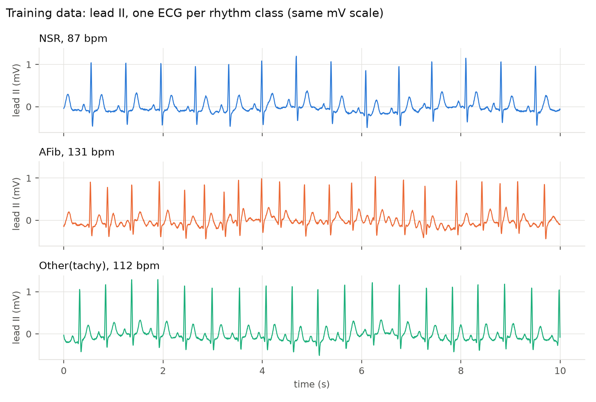

# ECG/AFib triage on 12-lead ECGs

> **Not for clinical use as provided.** Synthetic data only; any clinical use would need your own
> clinical validation and regulatory approval. See the [disclaimer](../../README.md#disclaimer).

Two models screen synthetic 12-lead electrocardiograms (ECGs): an arrhythmia (ARR) model flags
abnormal ones, and an atrial fibrillation (AFib) model classifies the flagged ones. The project
runs the whole model cycle on Databricks: generate training data, train, check the models on
held-out data, promote, serve, score a daily batch, and monitor.

**Contributors:** May Merkle-Tan ([@hengrumay](https://github.com/hengrumay)). To contribute, open
a pull request (see the root [Contributing](../../README.md#contributing) section) and add
yourself here.



## What's in it

| Part | What it does |
|---|---|
| Setup job | Generates training data, trains both models (small PyTorch networks, serverless GPU), checks them on held-out data, promotes them only if both pass, and serves them on two Model Serving endpoints |
| Daily job | Scores a simulated incoming batch with the same promoted models |
| Databricks App | Live triage: reads in a 12-lead ECG with a synthetic patient record and sends it to the endpoints |
| AI/BI dashboard | Batch results and live endpoint traffic, also embedded in the app |

Names, settings and validation thresholds live in [`common/config.py`](common/config.py); the data
in [`common/ecg_signal_gen.py`](common/ecg_signal_gen.py). Swap the data, the models or the rhythm
classes and the same cycle still applies.

## Quick start

`catalog` and `warehouse_id` are required; every setting is in
[Configuration](docs/deploy.md#configuration).

```bash
cd projects/ecg12-afib

# Jobs + dashboard (no local build)
databricks bundle deploy -p <profile> --var catalog=<catalog> --var warehouse_id=<id>
databricks bundle run ecg12_afib_setup -p <profile> --var catalog=<catalog> --var warehouse_id=<id>

# Everything, including the app (needs apx 0.3.8, uv, jq: see Prerequisites in docs/deploy.md)
./deploy.sh -p <profile> --catalog <catalog> --warehouse-id <id>
```

The setup job takes about 30 to 60 minutes (GPU training, then endpoint creation). The project
creates billable resources; see [Cost](docs/deploy.md#cost) and [Teardown](docs/deploy.md#teardown).

## More detail

| Page | What it covers |
|---|---|
| [How it works](docs/architecture.md) | A sketch of the workflows, folder layout, notebooks and jobs, batch vs live scoring |
| [Model lifecycle](docs/model-lifecycle.md) | Challenger, validation gate, champion; thresholds and evaluation charts |
| [Data](docs/data.md) | The synthetic 12-lead signal and patient record |
| [Dashboard](docs/dashboard.md) | Dashboard sections and the tables behind them |
| [Deploy](docs/deploy.md) | Settings, both deploy paths, permissions, cost, teardown |
| [Future work](docs/future-work.md) | Ideas not built yet |
| [Third-party licenses](docs/third-party-licenses.md) | Packages, versions, licenses and sources |
| [App](app/README.md) | Building the app |
| [Developer tools](dev/README.md) | Analysis scripts and optional local checks |
