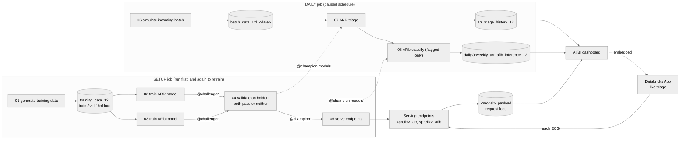

# How it works: workflows, folders and scoring paths

[← ecg12-afib README](../README.md)

## Sketch

Two Lakeflow jobs (workflows) feed one app and one dashboard. Every table and model sits in your
Unity Catalog catalog and schema, which belongs to this one deployment (see
[One schema per deployment](deploy.md#one-schema-per-deployment)).

The batch path loads the `@champion` models and scores on the job's driver; only the app calls
the endpoints, so live requests show up in the request-log tables and batch scoring does not.

## Layout

| Path | What it is |
|---|---|
| `databricks.yml` | Bundle `biosignals-ecg12-afib`: variables, targets `no_app` (jobs + dashboard) and `full` (+ the app) |
| `deploy.sh` | Full install from a laptop (target `full`): build, validate, deploy, SETUP run, permissions, app start, embedding allowlist |
| `resources/` | `ecg12_afib_setup.job.yml`, `ecg12_afib_daily.job.yml` (the jobs), `ecg12_afib.dashboard.yml` (the dashboard) |
| `workflow/` | Notebooks `00_`–`08_` (below). Each puts `..` on `sys.path` and imports `common` |
| `common/` | Shared code, single source of truth: `config.py` (names, `N_LEADS = 12`, aliases, training split + settings, validation thresholds, run date, the catalog/schema name check, the deployment identity, the MLflow experiment path check), `ecg_signal_gen.py` (12-lead generator), `training_data.py` (the persisted training dataset), `training.py` (PyTorch training loop, layer table), `evaluation.py` (metrics, the gate's threshold check, confusion counts, ROC / precision-recall curves, per-class table), `eval_plots.py` (the gate's evaluation figures), `ecg_plots.py` (sample-signal plots), `patient_info.py` (synthetic patient record), `scoring.py` (alias → version, driver-side scoring), `uc_io.py` (re-run-safe Delta writes, Delta versions, the schema-ownership record and check), `tracking.py` (the SETUP job's MLflow experiment, with its folder, made active), `deployment_path.py` (express or container image build, from a served model's build log and the endpoint's events) |
| `dashboards/` | `ecg12_afib.lvdash.json` (the dashboard the bundle deploys) and `build_ecg_demo_dashboard.py`, which generates it |
| `app/` | APX app (React UI + FastAPI backend). `backend/common/` is a byte-identical copy of `common/{__init__,config,ecg_signal_gen,patient_info}.py`; the build fails if it drifts. Build with `app/build_from_lockfiles.sh`, see [`app/README.md`](../app/README.md) |
| `dev/` | Developer tools, not deployed (excluded from bundle sync, outside the app wheel): `signal_variety/` checks how varied and how separable the generator's ECGs are; `tests/` holds optional local checks (see [Tests](../dev/tests/README.md)); see [`dev/README.md`](../dev/README.md) |

## Notebooks and jobs

| Notebook | Job → task | Writes | Compute |
|---|---|---|---|
| `00_overview` | — | Docs: the whole flow on one page, the 12-lead legend | — |
| `01_generate_training_data` | SETUP → `generate_training_data` | the schema if it does not exist; on the first run `ecg12_afib_deployment` (this deployment owns the schema; stops first if another one does); `training_data_12l` (`train` 600 / `val` 200 / `holdout` 200 ECGs by default) + sample plots | standard serverless, environment 6 |
| `02_train_arr_model` | SETUP → `train_arr_model` (after 01) | MLflow run in the `mlflow_experiment` experiment (incl. the layer table); new version of `bio_ecg12_arr` → `@challenger` | serverless GPU (A10, AI v6) |
| `03_train_afib_model` | SETUP → `train_afib_model` (after 01, parallel with 02) | MLflow run in the `mlflow_experiment` experiment (incl. the layer table); new version of `bio_ecg12_afib` → `@challenger` | serverless GPU (A10, AI v6) |
| `04_validate_and_promote` | SETUP → `validate_and_promote` (after 02 + 03) | gate run (same experiment) with hold-out metrics + evaluation artifacts; both pass → `@champion` moves to the challengers, else the task fails | serverless GPU (A10, AI v6) |
| `05_serve_endpoints` | SETUP → `serve_endpoints` (after 04) | endpoints `<endpoint_prefix>_arr`, `<endpoint_prefix>_afib` at `@champion` (stops if one already serves another deployment's model) + inference tables `<model>_payload` + AI Gateway usage tracking; prints each endpoint's deployment path and tags it `deployment` | standard serverless, environment 6 |
| `06_generate_batch_data` | DAILY → `simulate_incoming_batch` | (stops first unless `ecg12_afib_deployment` names this deployment) `batch_data_12l_<YYYYMMDD>`: simulated incoming data, not real ingestion (acquisition times spread over the clinic day) + sample plot | standard serverless, environment 6 |
| `07_arr_triage` | DAILY → `arr_triage` (after 06) | `arr_triaged_12l_<YYYYMMDD>` and that date's rows of `arr_triage_history_12l` (scored on the driver) | standard serverless, environment 6 |
| `08_afib_classify` | DAILY → `afib_classify` (after 07) | that date's rows of `dailyOrweekly_arr_afib_inference_12l` (scored on the driver) | standard serverless, environment 6 |

Every notebook takes `catalog_name` (required: the jobs pass the bundle's `catalog` variable; when
you run a notebook by hand, type it into the widget) and `schema_name` (default `biosignals`); both
must be letters, digits and underscores. The DAILY notebooks also take `run_date`. The first task
of each job (`01_`, `06_`) also takes `deployment_id`, which both jobs pass as
`<workspace id>:<bundle root path>`; by hand, copy it from `ecg12_afib_deployment`.

Run SETUP first (and again to retrain); DAILY needs its champion models. The DAILY job has a paused
06:00 UTC schedule and one `run_date` job parameter (default `{{job.start_time.iso_date}}`) that
every task reads; set `run_date=YYYY-MM-DD` to backfill a day. Re-running a date gives the same
rows and never duplicates them: per-date tables are overwritten, and the accumulating tables
(`arr_triage_history_12l`, `dailyOrweekly_arr_afib_inference_12l`) get that date's rows replaced
in one Delta transaction; `uc_io.write_date_slice` refuses any existing table without
`batch_date`.

## Batch path vs live path

- **Batch** (DAILY job): `07_` / `08_` resolve `champion` to a concrete version, load exactly that
  version with `mlflow.pyfunc.load_model` and score the day's roughly 100 ECGs on the job's driver
  (`scoring.score_driver_side`, as the gate does), recording the version in `arr_model_info` /
  `afib_model_info`. The endpoints are not called. Results: `arr_triaged_12l_<date>`,
  `arr_triage_history_12l`, `dailyOrweekly_arr_afib_inference_12l`.
- **Live** (the app): each *Triage → Classify* sends one ECG to the triage endpoint
  (`<endpoint_prefix>_arr`) and, when flagged, to the classify endpoint (`<endpoint_prefix>_afib`);
  AI Gateway logs the requests and responses to `bio_ecg12_arr_payload` /
  `bio_ecg12_afib_payload`, with a delay ("You can expect logs to be available within 1 hour of a
  request") and with documented gaps: a request or response over 1 MiB is not logged, and for
  custom model endpoints such as these "logs may not be recorded for any 4xx or 5xx errors"
  ([inference tables for serving endpoints](https://docs.databricks.com/aws/en/ai-gateway/inference-tables-serving-endpoints)). One 12-lead
  ECG is about 650 KB of JSON, inside that 1 MiB logging limit; a request above 1 MiB is served but
  logged with `MAX_REQUEST_SIZE_EXCEEDED` and a null payload, so `05_`'s smoke test and the app's
  warm-up pings also send one ECG per request. So the app itself writes no table, but the tables
  hold the ECGs from logged requests: each logged request holds the whole ECG, and its response
  the scores. Anyone in `viewer_group` (default `users`) can use
  the app and so add rows. That is fine for this synthetic data; if you adapt the project to real
  data, treat the two payload tables as patient data (limit who can `SELECT` them, and narrow
  `viewer_group`).
  AI Gateway usage tracking is on as well: usage records for the endpoints' requests land in the
  system table `system.serving.endpoint_usage`, which only account admins can query unless one grants access.

**Scale-to-zero and the app.** Both endpoints scale to zero when idle, and waking one took 89 s and
130 s when this demo was tested. So every endpoint call from the app is bounded by
`SERVING_TIMEOUT_S` (30 s, `common/config.py`; the databricks-sdk `http_timeout_seconds` and
`retry_timeout_seconds` of the app's serving client): a call that hits it returns HTTP 503 with a
"waking up from scale-to-zero, try again" message instead of hanging; a rate-limited call returns
429 and any other endpoint error 502, each with the endpoint and a message the UI shows. The UI gives
*Triage → Classify* its own limit of 80 s (two bounded calls plus a margin), a Cancel button and
Retry. While the Live tab is visible it calls `POST /api/warmup` on load, again right away while an
endpoint is still cold, then every `WARMUP_INTERVAL_S` (600 s, inside the endpoints' idle window),
stops while the page is hidden, and shows a ready / waking / cold / error chip per endpoint. Each
warm-up ping is one single-ECG request per endpoint with `client_request_id = app-warmup`
(`WARMUP_REQUEST_ID`), so it is one row in that endpoint's payload table, which the dashboard leaves
out of its live tiles and counts separately. The pings use only the app's `CAN_QUERY` grant.

**Express deployment (faster endpoint updates).** Model Serving has a faster way to start a custom
model, [express deployment](https://docs.databricks.com/aws/en/machine-learning/model-serving/express-deployments):
for an eligible model it prepares the model's Python environment once and reuses it, instead of
building a new container image every time an endpoint is created or updated. On AWS and Azure it is
automatic; there is nothing to switch on. In the docs' terms, a model is eligible when it was logged
with MLflow from Databricks compute and its recorded runtime, Python version and dependencies are
compatible with the serving compute; what can prevent it includes Git, URL, editable or
package-index entries in its pip requirements, CUDA-tagged versions, a Conda-only environment and
PySpark (exact pins are required only for torch packages on a GPU endpoint; these endpoints are
CPU). This project avoids all of those, though we have not tested which part of its setup express
needed. The notebooks that log, load or serve the models
run one MLflow version, 3.13 (it records the serverless environment version with the model): `02_`
to `04_` get it with their environment (the AI Runtime environment 6, AI v6, ships it), and `05_`,
`07_` and `08_` install it over the 3.12 that standard serverless environment 6 ships (`07_` and
`08_` also install the models' torch 2.11.0, which environment 6 does not ship). No notebook
installs a package version below the one its environment ships: an older databricks-sdk or protobuf
than the environment's stops the Python kernel from restarting. And `02_` and `03_` log
each model with an explicit list, `MODEL_PIP_REQUIREMENTS` in `common/config.py`: only mlflow,
cloudpickle, numpy, pandas and torch, each at the exact version of the training environment (the
model is pickled there and must load with the same versions; torch 2.11.0 without the environment's
`+cu130` CUDA tag), instead of the list MLflow would work out from the notebook session. The first
deployment of a model can still take longer while its environment is prepared. To see which path an
endpoint took, read its events after a create or update (`databricks api get
/api/2.0/serving-endpoints/<name>/events`): a *Container image creation* event means
the standard path (when this demo was tested on that path, the image build took about 15 of the 21
minutes an endpoint took to become ready); with express deployment that event is absent and
*Model artifact preparation* events take its place. `05_` does that check itself once both endpoints
are ready (`common/deployment_path.py`, from the served model's build log and the endpoint's
events): it prints one line per endpoint, such as `bio_ecg12_arr-2: EXPRESS deployment (environment
prepared in 4m00s; no container image build)`, and tags the endpoint `deployment` = `express`,
`standard` or `unknown`. The build log comes first: an update that keeps a served model reuses its
prepared environment and adds no new events, and its build log still begins "This environment was
prepared ahead of time by express deployment". `unknown` means the build log or the events could
not be read (an API error, a timeout, an unexpected response) or they named neither path, not that
express was not used. Both reads are needed: a container image build (express that fell back) shows
only in the events, so an express build log without readable events is `unknown`, not `express`. Anything but `express` is a printed warning, not a failed task, because eligibility is Model
Serving's decision and the endpoint serves either way.
In the Serving UI the build log is under the endpoint's **Logs > Build logs** (pick the served
model). Tested end to end on AWS and on Azure, with both endpoints on the express path; on Google
Cloud the express deployment page still requires `env_pack`, which this project doesn't use, so
expect the standard path there (not yet tested). More, including what to do when an endpoint falls
back to the standard path: [Express deployment](express-deployment.md).
