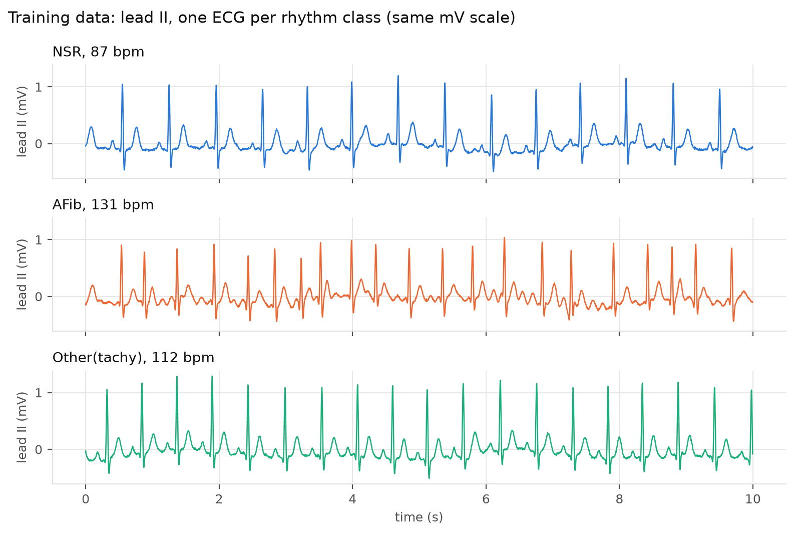
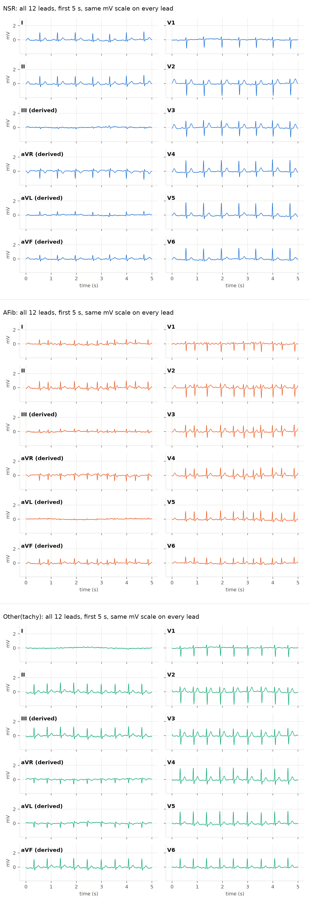

# The synthetic 12-lead signal and patient record

[← ecg12-afib README](../README.md)

## The 12-lead signal and patient record

*Generated by the project's own code (`common/ecg_signal_gen.py`, `common/ecg_plots.py`, seed 11:
the training-data draw `01_generate_training_data` makes). Blue: normal sinus rhythm (NSR);
orange: AFib; green: other (sinus tachycardia).*

- **Leads.** With electrodes on the arms, the left leg and across the chest, a standard ECG records
  the heart's electrical activity from 12 directions at once: the limb leads I, II, III and the
  augmented limb leads aVR, aVL, aVF look at the heart in the body's front-facing, vertical
  (frontal) plane, and the chest (precordial) leads V1–V6 in the plane that cuts across the body
  (horizontal). Background: AHA/ACCF/HRS *Recommendations for the Standardization and Interpretation of the Electrocardiogram, Part I* (Kligfield et al., Circulation 2007). Each lead
  sees the same beat from a different direction. Only eight are
  independent: I and II (frontal-plane projections of per-wave cardiac vectors) and V1–V6 (normal
  R-wave progression) are synthesized; III, aVR, aVL, aVF are derived from I and II (Einthoven's
  law, Goldberger's leads): `III = II − I`, `aVR = −(I + II)/2`, `aVL = I − II/2`, `aVF = II − I/2`.
  Values are in mV, 250 Hz, 10 s. Stored as `ecg1`..`ecg12` in that lead order (column comments in
  UC say which is which). `00_overview` and the app (under the ECG chart) carry the same legend.
- **Rhythms.** NSR (normal sinus rhythm, 60–100 bpm), AFib (irregular RR, no P waves, f-waves,
  100–160 bpm), Other = sinus tachycardia (110–160 bpm). These are the ranges the rates are drawn
  from; `heart_rate_bpm` is measured from the beats, and AFib's irregular beats measure below
  100 bpm for about 2–5 % of AFib ECGs. All classes share one beat model (the same wave shapes),
  but they differ in more than rhythm: AFib alone has no P waves, an added fibrillatory baseline
  (f-waves) and more beat-to-beat amplitude scatter.
- **Patient record** (synthetic, non-PII): `pseudo_patient_id`, `mrn`, `age_years`, `sex`,
  `height_cm`, `weight_kg`, `bmi` (from height and weight), `bp_systolic_mmhg`,
  `bp_diastolic_mmhg`, `acquisition_datetime_utc`, `heart_rate_bpm` (measured from the ECG),
  `sampling_rate_hz`, `n_leads`, `duration_s`. Demographics are fixed per `pseudo_patient_id`;
  AFib is assigned more often to older patients. Acquisition times fall in clinic hours
  (07:00–19:00 UTC, a busier morning), so a day's batch reads like an incoming stream.
