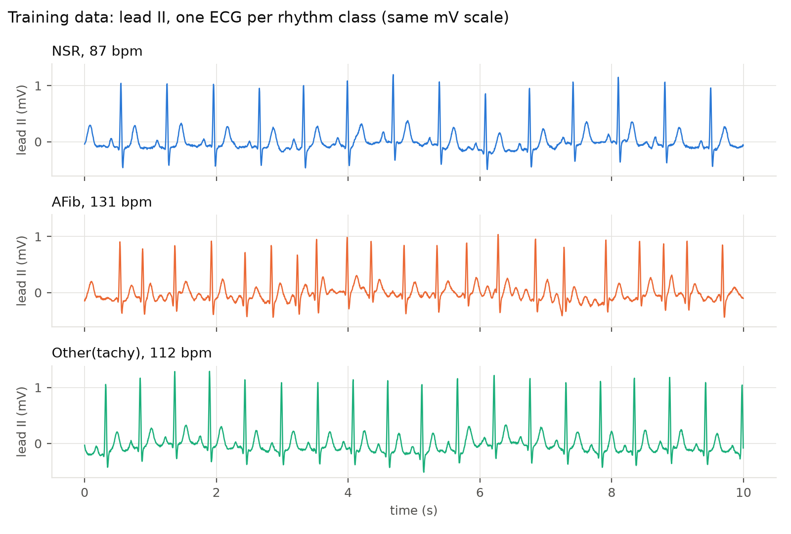
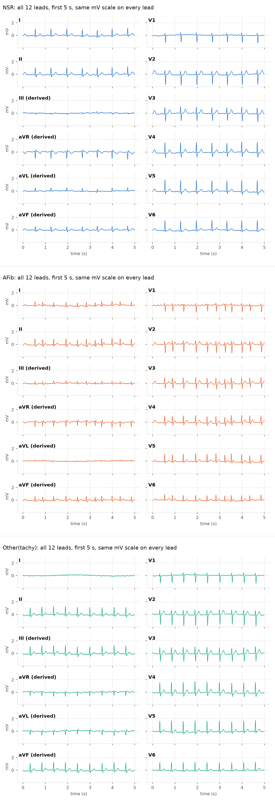

# The synthetic 12-lead signal and patient record

[← ecg12-afib README](../README.md)

## The 12-lead signal and patient record

*Generated by the project's own code (`common/ecg_signal_gen.py`, `common/ecg_plots.py`, seed 11:
the training-data draw `01_generate_training_data` makes). Blue: normal sinus rhythm (NSR);
orange: AFib; green: other (sinus tachycardia).*

- **Leads.** A standard ECG gives 12 views of the heart's electrical activity: six in the frontal
  (vertical) plane from the limb leads I, II, III and the augmented limb leads aVR, aVL, aVF, and six
  in the horizontal plane from the chest (precordial) leads V1–V6 (Merck Manual Professional,
  *Electrocardiography*). Each lead sees the same beat from a different direction. Only eight are
  independent: I and II (frontal-plane projections of per-wave cardiac vectors) and V1–V6 (normal
  R-wave progression) are synthesized; III, aVR, aVL, aVF are derived from I and II (Einthoven's
  law, Goldberger's leads): `III = II − I`, `aVR = −(I + II)/2`, `aVL = I − II/2`, `aVF = II − I/2`.
  Values are in mV, 250 Hz, 10 s. Stored as `ecg1`..`ecg12` in that lead order (column comments in
  UC say which is which). `00_overview` and the app (under the ECG chart) carry the same legend.
- **Rhythms.** NSR (normal sinus rhythm, 60–100 bpm), AFib (irregular RR, no P waves, f-waves,
  100–160 bpm), Other = sinus tachycardia (110–160 bpm). All classes share one beat model, so they
  differ only in rhythm.
- **Patient record** (synthetic, non-PII): `pseudo_patient_id`, `mrn`, `age_years`, `sex`,
  `height_cm`, `weight_kg`, `bmi` (from height and weight), `bp_systolic_mmhg`,
  `bp_diastolic_mmhg`, `acquisition_datetime_utc`, `heart_rate_bpm` (measured from the ECG),
  `sampling_rate_hz`, `n_leads`, `duration_s`. Demographics are fixed per `pseudo_patient_id`;
  AFib is assigned more often to older patients. Acquisition times fall in clinic hours
  (07:00–19:00 UTC, a busier morning), so a day's batch reads like an incoming stream.
